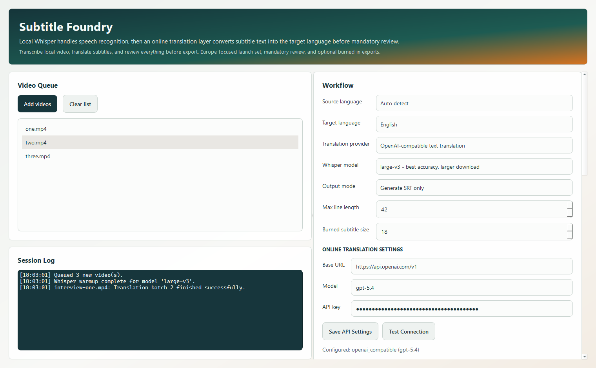
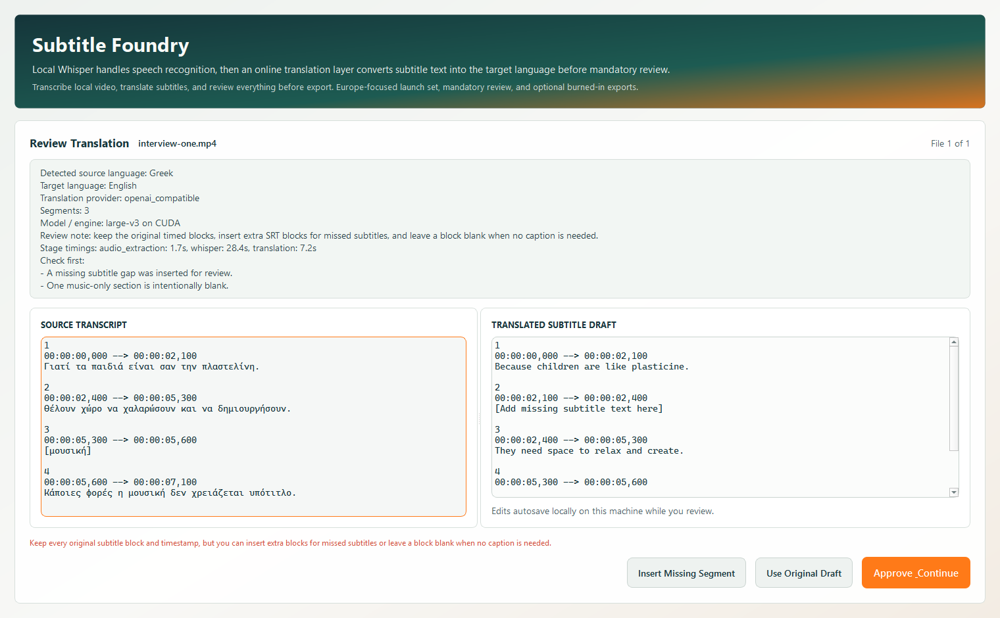

# Subtitle Foundry

Cross-platform desktop app for transcribing spoken video, translating subtitle text, and exporting subtitle files with optional burned-in video.

The current release is a Europe-focused multilingual workflow: local Whisper handles speech recognition, an online text-translation provider handles target-language translation, and the app always pauses for review before export.

## What It Does

- Select one or more videos from anywhere on disk.
- Choose the source language or let Whisper detect it.
- Choose a target subtitle language from the launch set.
- Transcribe speech locally with faster-whisper by default, then translate subtitle text through an OpenAI-compatible API.
- Review the source transcript and translated SRT side by side before export.
- Export an `.srt` file.
- Optionally burn the subtitles directly into a new video file.
- Run local transcription with `faster-whisper` by default and a bundled FFmpeg binary while keeping translation text-only.

## Cut & Cover (audio interviews, removing parts)

The **Cut & Cover** card prepares media before transcription:

- **Time ranges to remove**: paste one range per line, e.g. `00:10-00:13` or
  `1:02:03-1:02:30`. Blank lines are fine, and `7:55` works as well as `07:55`.
  The card shows how many cuts were read and how much time they remove, or
  which line is wrong. Cuts apply to every file in the queue.
- **Audio files** (`.mp3`, `.wav`, `.m4a`, ...) can be added to the queue. They
  are turned into a 1920×1080 video using the **cover image** (fitted with black
  bars), or a black picture if no image is chosen.

- **Portrait photos** get a portrait video of the same shape (e.g. a 3:4 photo
  becomes 1080×1440); landscape photos use 1920×1080.
- **Intro/outro logo** (optional, audio files): the logo is shown on white,
  blurs away into the photo before the interview, and returns at the end. The
  intro and outro are silent.
- **Show a moving audio wave** (optional, audio files): a dark dotted waveform
  that moves with the voice, in the lower middle of the picture.
- **Burned subtitle style → White with black outline (interview)**: white text
  with a black outline and shadow instead of the dark box (size 11 suits it).

These options are ignored for video files, so other jobs are unchanged.

The edited file is saved in the output folder as `<name>.edited.mp4`, and the
rest of the job (Whisper, translation, review, burn) runs on it, so subtitle
times match the edited version. For an audio interview with a photo and a cut
list: add the audio, paste the cuts, pick the photo, set the target to
**English**, and choose **Generate SRT and burned-in video**.

## Screenshots

Main dashboard:



Review workflow:



## Launch Languages

For reels with Greek and English speech, choose **Mixed Greek and English** as
the source. Choose **Opposite language (Greek ↔ English)** as the target for
Greek speech → English subtitles and English speech → Greek subtitles in one
SRT/video. Selecting this target also selects the mixed source automatically.
For mixed speech with English-only subtitles, keep the mixed source and choose
**English** as the target. Mixed transcription uses faster-whisper on CPU or CUDA.
Review every language switch before export, including each phrase in blocks
containing both languages. Recognition and translation can still need correction.

For the Centredot reels: process `Chefs.mov` with the opposite-language target,
then process the other two videos in a separate run with the English target.
Choose **Generate SRT and burned-in video** to export captioned reels.

- English
- Greek
- Turkish
- German
- French
- Italian
- Spanish
- Portuguese
- Dutch
- Romanian
- Polish
- Czech

## Why Local Whisper + Online Translation

Speech recognition stays local so large video audio does not have to be uploaded, and Whisper can keep using your CPU or GPU directly. Translation is handled separately through an OpenAI-compatible text API so the app can support many target languages instead of Whisper's built-in translate-to-English-only path.

## Quick Start

1. Install `uv` if you do not already have it: https://docs.astral.sh/uv/
2. Sync the project:

```bash
uv sync
```

3. Launch the desktop app:

```bash
powershell -ExecutionPolicy Bypass -File .\scripts\launch_windows_outside_venv.ps1
```

On Windows, the recommended launcher is `launch-subtitle-foundry.vbs`. It starts the app from a user-level Python 3.12 install outside the repo `.venv`, installs the external runtime dependencies automatically if they are missing, and keeps normal day-to-day app runs out of the project virtual environment.

For local development tasks such as running tests, packaging, or editing dependencies, keep using `uv` commands from the repo as usual.

Before running translated workflows, configure these values in the app:

- Translation base URL
- Translation model
- Translation API key

If the source and target languages match, the app can run transcription-only without translation credentials.

## Notes

- The first run downloads the selected Whisper model, so it can take a while.
- If you want higher Hugging Face download rate limits for that first model fetch, optionally set `HF_TOKEN` before launching the app.
- `large-v3` is the default because accuracy matters more than speed for subtitle review, and it now runs through `faster-whisper` by default on CPU and CUDA systems.
- Whisper is used only for transcription and language detection. Many-to-many translation is handled by the configured text provider.
- On Windows x64, the project is pinned to the official CUDA 12.4 PyTorch wheel so NVIDIA GPUs can be used automatically when available.
- Burned-in subtitle exports are written with a new `.subtitled` suffix so your original files stay untouched.
- The app surfaces active file, queue position, elapsed time, active engine, translation-provider status, subtitle preview, and automatic review flags so you can tell when the workflow needs human attention.

## Packaging Direction

- The app is built with `PySide6`, so the next packaging step is `pyside6-deploy` or a platform-specific packager such as PyInstaller.
- Plan to build native installers separately on Windows, macOS, and Linux.
- `openai-whisper` remains available as a compatibility fallback for environments where `faster-whisper` is not a fit.
- If you later want an even more specialized GPU-focused backend on specific machines, `whisper.cpp` is the next option to evaluate.

## Windows Packaging

Build a branded Windows app bundle:

```bash
powershell -ExecutionPolicy Bypass -File .\scripts\build_windows_bundle.ps1
```

Build a branded Windows installer:

```bash
powershell -ExecutionPolicy Bypass -File .\scripts\build_windows_installer.ps1
```

Outputs:

- App bundle: `dist\SubtitleFoundry\SubtitleFoundry.exe`
- Installer: `build\installer\subtitle-foundry-setup.exe`

## Testing

```bash
uv run pytest
```
